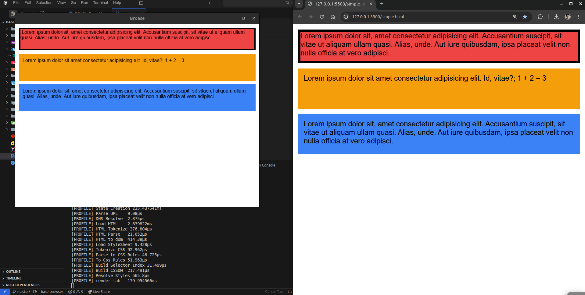

# Base Browser

**A web browser built from scratch in Rust.**

Base Browser is a personal systems programming project focused on understanding how web browsers work under the hood. Rather than wrapping an existing browser engine, the goal is to progressively implement the core components responsible for transforming HTML and CSS into rendered pixels.

The project is both a practical exploration of Rust and a long-term effort to build a full-featured browser engine, with the eventual ambition of approaching the capabilities of modern browsers such as Chrome.

## Current Progress

- **HTML & CSS:** Working HTML and CSS parsers.
- **Layout Engine:** Under active development, translating parsed documents into renderable layouts.
- **Rendering:** Work in progress, currently capable of rendering block elements and text.
- **Font Resolution:** Font selection and resolution are implemented, with text rendering across different fonts still being refined.
- **Browser Architecture:** Modular Rust components for browser logic, parsing, layout, rendering, networking, and font handling.

## Goals

- Deepen my understanding of Rust through a substantial, evolving systems project.
- Explore browser internals, networking, HTTP/HTTPS, and the process of turning web documents into pixels.
- Develop stronger technical problem-solving skills through implementing and debugging complex software components.
- Progressively build foundational browser technologies, including layout, text rendering, resource loading, and eventually richer web content support.

## Roadmap

The long-term goal is to evolve Base Browser into a more complete browser, progressively adding inline layout, images, video, broader CSS support, improved networking, and other capabilities expected of a modern browser.

**Status:** Early development. Core parsing components are working, while layout and rendering continue to evolve.
